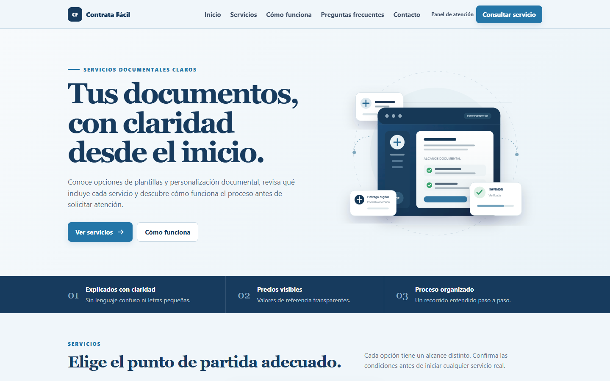
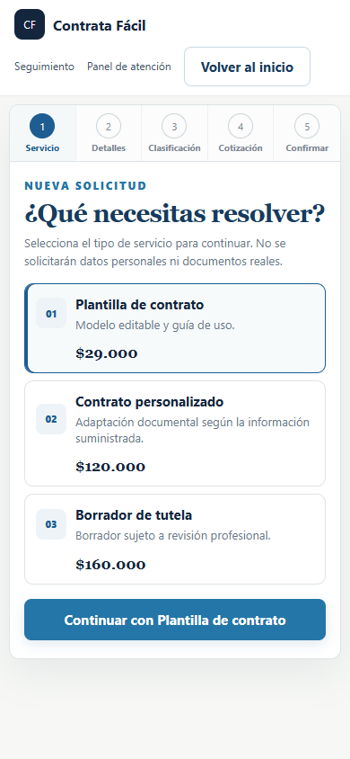
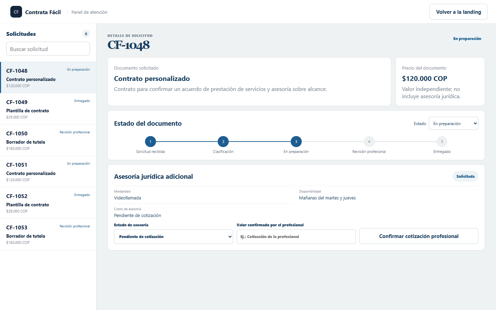
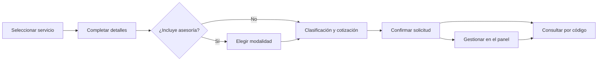

<div align="center">

<h1>Contrata Fácil</h1>
<p><strong>Solicitudes documentales, cotización y seguimiento en una sola experiencia.</strong></p>
<p>
  
  
  
  
</p>
<p><a href="#demostración">Demostración</a> · <a href="#instalación">Instalación</a> · <a href="#despliegue-en-vercel">Despliegue</a> · <a href="#contribución">Contribución</a></p>

</div>

Contrata Fácil es una aplicación web demostrativa para explorar servicios documentales en Colombia. Puedes recorrer una solicitud con datos ficticios, consultar la cotización de referencia y seguir el estado del documento. El panel de atención permite simular el trabajo de quien atiende la solicitud.

## Demostración

### Capturas de pantalla



| Solicitud en móvil | Panel de atención |
| --- | --- |
|  |  |

## Características

- Catálogo, proceso, preguntas frecuentes y acceso a la solicitud inicial.
- Formulario con campos específicos para cada servicio y cotización en pesos colombianos.
- Asesoría jurídica opcional por llamada, videollamada o cita presencial, con cotización independiente.
- Seguimiento mediante código y panel con estados de documento y asesoría independientes.
- Diseño adaptable a móvil y escritorio.

## Servicios

| Servicio | Precio de referencia | Alcance |
| --- | ---: | --- |
| Plantilla de contrato | $29.000 COP | Modelo editable y guía de uso |
| Contrato personalizado | $120.000 COP | Adaptación documental según el alcance |
| Borrador de tutela | $160.000 COP | Borrador sujeto a revisión profesional |

## Cómo funciona

1. Elige un servicio y describe un caso ficticio.
2. Si quieres explorar la asesoría adicional, elige una modalidad e indica una disponibilidad general.
3. Revisa la clasificación, el precio del documento y las condiciones de la cotización.
4. Confirma la solicitud de demostración y copia el código para consultar su estado.



## Experiencia interactiva

| Ruta | Qué puedes probar |
| --- | --- |
| `#inicio`, `#servicios`, `#como-funciona` | Inicio, catálogo y proceso |
| `#faq`, `#contacto`, `#consulta` | Preguntas frecuentes, acceso a la solicitud y formulario inicial |
| `#/solicitud` | Selección, detalles, cotización y confirmación |
| `#/seguimiento` | Consulta de una solicitud por código |
| `#/panel` | Gestión de las solicitudes de demostración |

Prueba el código `CF-1048` para consultar un caso precargado. Mantén la misma pestaña para ver en seguimiento los cambios que hagas en el panel.

## Panel de atención

Busca solicitudes por código, servicio o resumen. Selecciona una para cambiar el estado del documento y, si incluye asesoría, registrar su cotización y su estado. Al marcar un documento como **Entregado**, puedes descargar un archivo de texto de muestra.

## Tecnologías

| Tecnología | Uso |
| --- | --- |
| React 18 | Interfaz, navegación por fragmentos y estado en memoria |
| TypeScript 5 | Tipado y comprobación estática |
| Vite | Desarrollo, compilación y vista previa |
| HTML, CSS y SVG | Estructura, estilos adaptables e iconografía |

## Instalación

Necesitas Git, Node.js 22.12 o posterior de la serie 22 y npm.

```bash
git clone https://github.com/isyoimerr/ContratraFacil.git
cd ContratraFacil
npm install
npm run dev
```

Abre la dirección que indica Vite. Para comprobar el resultado de producción, compila y ejecuta la vista previa.

```bash
npm run build
npm run preview
```

El build incluye la comprobación de TypeScript. El proyecto carece de scripts separados de lint y pruebas automatizadas.

## Despliegue en Vercel

1. Importa `isyoimerr/ContratraFacil` desde el panel de Vercel.
2. Selecciona el preset **Vite**, la rama de producción `main` y Node.js **22.x**.
3. Verifica que el comando de build sea `npm run build` y que el directorio de salida sea `dist`.
4. Ejecuta **Deploy** y usa la URL que muestre Vercel para comprobar inicio, solicitud y seguimiento.

La aplicación usa la configuración predeterminada de Vite, funciona sin variables de entorno y navega mediante fragmentos de URL. [Documentación de Vite en Vercel](https://vercel.com/docs/frameworks/frontend/vite)

## Estructura del proyecto

```text
.
├── docs/screenshots/       Capturas de la aplicación
├── src/
│   ├── main.tsx            Punto de entrada de React
│   ├── App.tsx             Página pública, navegación y estado compartido
│   ├── prototype.tsx       Solicitud, seguimiento y panel de atención
│   ├── styles.css          Estilos de la página pública
│   ├── visual-overrides.css Ajustes visuales y responsive
│   └── prototype.css       Estilos del flujo y del panel
├── index.html              Entrada HTML de Vite
└── vite.config.ts          Configuración de Vite
```

## Alcance actual

La aplicación es un sitio estático. Las solicitudes de demostración viven en memoria y se reinician al recargar la página. El panel es público para facilitar la evaluación. Usa solo datos ficticios. La cotización y la entrega son simulaciones sin pagos, backend ni autenticación. Cualquier revisión o asesoría jurídica real requiere intervención profesional habilitada.

## Próximas mejoras

- Incorporar pruebas automatizadas del recorrido de solicitud y seguimiento.
- Para un servicio real, incorporar persistencia, autenticación y control de acceso al panel.

## Contribución

1. Crea una rama desde `main`.
2. Ejecuta `npm run build` y comprueba el flujo afectado con la vista previa.
3. Abre una solicitud de cambios con el alcance y los pasos de verificación.

## Estado del proyecto

**v1.0.0 · Primera versión funcional de la demostración académica.** El repositorio carece de una licencia publicada.

<hr>
<div align="center">
  <strong>Contrata Fácil</strong> · Proyecto académico de servicios documentales
</div>
